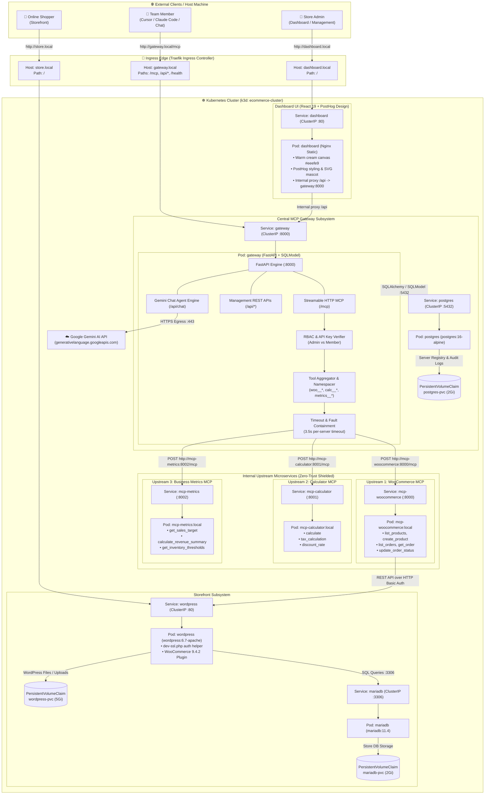
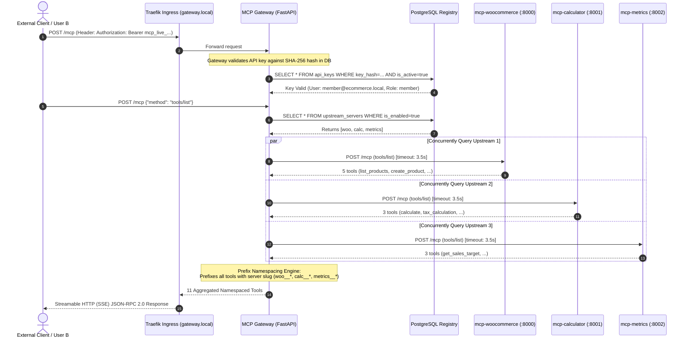
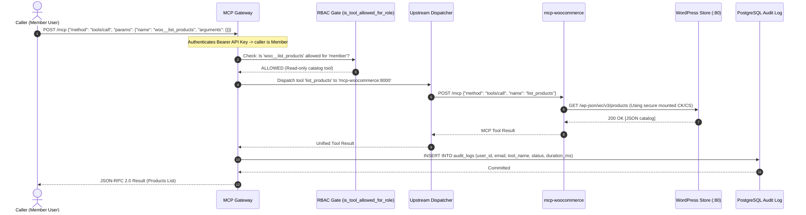
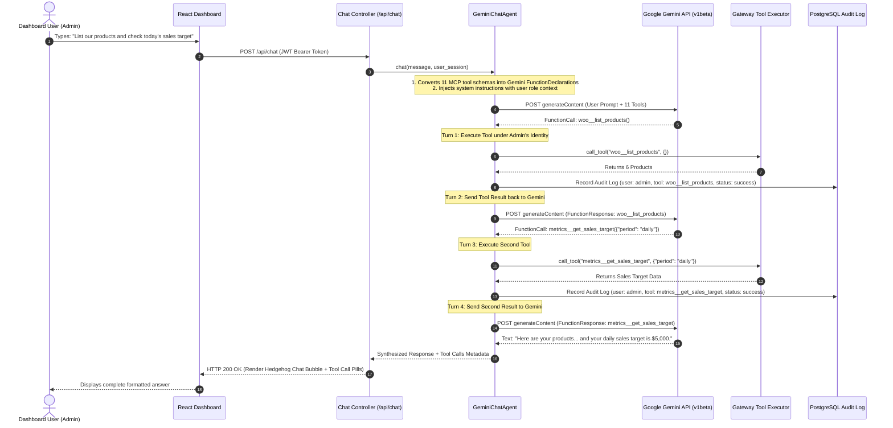

# System Architecture & Technical Decision Record (TDR)

> **WooCommerce Hosting Platform with Centralized Team MCP Gateway on Kubernetes**  
> *Author:* Vishal Kumar  
> *Target:* Urumi AI FDE Internship — Round 1 Technical Submission & Round 2 Defense  
> *Repository:* `kube-ecommerce`

---

## Table of Contents
1. [Executive Summary & System Topology](#1-executive-summary--system-topology)
2. [Component Inventory & Container Roles](#2-component-inventory--container-roles)
3. [End-to-End Request Flows & Sequence Diagrams](#3-end-to-end-request-flows--sequence-diagrams)
   - 3.1. MCP Protocol Handshake & Tool Discovery
   - 3.2. Authenticated Tool Execution (tools/call)
   - 3.3. AI Chat Agent Function-Calling Loop
   - 3.4. Chaos & Fault-Tolerance Containment
4. [Day-by-Day, Phase-by-Phase Architectural Decisions (The "Why")](#4-day-by-day-phase-by-phase-architectural-decisions-the-why)
   - Days 1 & 2: Local Cluster & Stateful WooCommerce
   - Day 3: Custom WooCommerce MCP Server
   - Days 4 & 5: Central MCP Gateway & Aggregation Engine
   - Days 6 & 7: Multi-User RBAC, API Keys & Audit Trail
   - Days 8 & 9: PostHog-Inspired Dashboard & AI Chat Agent
   - Days 10 & 11: Zero-Trust NetworkPolicies & 15-Point DoD Suite
   - Days 12–14: Production VPS Architecture & Cloud Readiness
5. [Security Architecture & Trust Boundaries](#5-security-architecture--trust-boundaries)
6. [Data Persistence & Failure Isolation](#6-data-persistence--failure-isolation)
7. [Local (k3d) vs Production (VPS/k3s) Configuration Strategy](#7-local-k3d-vs-production-vpsk3s-configuration-strategy)
8. [Round 2 Technical Interview Walkthrough & Defense](#8-round-2-technical-interview-walkthrough--defense)

---

## 1. Executive Summary & System Topology

The platform provides a secure, multi-tenant WooCommerce hosting environment paired with a centralized **Model Context Protocol (MCP)** gateway. It solves a fundamental problem in enterprise AI adoption: **how can a team connect AI agents (Claude Code, Cursor, MCP Inspector, internal chatbots) to internal corporate systems (WooCommerce, billing, inventory) without distributing master credentials or exposing internal databases to the public internet?**

### The Core Architectural Pattern: Dual-Personality Gateway
The Central MCP Gateway operates in two distinct roles simultaneously:
1. **MCP Server toward External Clients**: Exposes a unified outward-facing endpoint (`http://gateway.local/mcp`) accepting Streamable HTTP / JSON-RPC 2.0 requests authenticated via team Bearer API keys (`mcp_live_...`).
2. **MCP Client toward Internal Upstream Microservices**: Acts as an HTTP client querying multiple isolated internal upstream servers (`mcp-woocommerce:8000`, `mcp-calculator:8001`, `mcp-metrics:8002`).



---

## 2. Component Inventory & Container Roles

| Workload | Container Image | ClusterIP Port | Public Route | Storage Volume | Security / Network Boundaries |
| :--- | :--- | :---: | :---: | :---: | :--- |
| **Traefik Ingress** | Built-in k3d/k3s | 80, 443 | `localhost:80, :443` | Stateless | Ingress controller routing based on HTTP `Host` header. |
| **WordPress** | `wordpress:6.7-apache` | `:80` | `http://store.local` | `wordpress-pvc` (5Gi) | Stores core PHP files, uploads, and WooCommerce plugin. Ingress allowed from Traefik and `mcp-woocommerce`. |
| **MariaDB** | `mariadb:11.4` | `:3306` | *Internal Only* | `mariadb-pvc` (2Gi) | Stores store catalog, orders, and users. Ingress strictly allowed **only from WordPress pod**. |
| **MCP Gateway** | `mcp-gateway:v1` | `:8000` | `http://gateway.local` | Stateless (Postgres DB) | Central routing, dynamic tool discovery, team authentication, RBAC enforcement, and audit logging. |
| **PostgreSQL** | `postgres:16-alpine` | `:5432` | *Internal Only* | `postgres-pvc` (2Gi) | Gateway registry, user accounts, hashed API keys, and audit log events. Ingress strictly allowed **only from Gateway pod**. |
| **Dashboard** | `ecommerce-dashboard:local` | `:80` | `http://dashboard.local` | Stateless | PostHog-styled SPA running on Nginx. Proxies `/api/*` to Gateway. Ingress allowed from Traefik. |
| **MCP WooCommerce** | `mcp-woocommerce:local` | `:8000` | *Internal Only* | Stateless | Translates MCP tool calls into WooCommerce REST API calls. Ingress strictly allowed **only from Gateway pod**. |
| **MCP Calculator** | `mcp-calculator:local` | `:8001` | *Internal Only* | Stateless | Fast deterministic calculation engine. Ingress strictly allowed **only from Gateway pod**. |
| **MCP Metrics** | `mcp-metrics:local` | `:8002` | *Internal Only* | Stateless | Business KPI and revenue analysis engine. Ingress strictly allowed **only from Gateway pod**. |

---

## 3. End-to-End Request Flows & Sequence Diagrams

### 3.1. MCP Protocol Handshake & Tool Discovery
When a client (such as Cursor, Claude Code, or the Dashboard) connects to `http://gateway.local/mcp`, the Gateway performs dynamic tool aggregation across all healthy upstream servers:



---

### 3.2. Authenticated Tool Execution (`tools/call`) with RBAC & Audit Logging
Every tool invocation passes through three gates: Identity Validation $\rightarrow$ Role-Based Authorization $\rightarrow$ Post-Execution Audit Recording:



---

### 3.3. AI Chat Agent Function-Calling Loop (`POST /api/chat`)
The dashboard chat agent acts as a conversational facade that uses Google Gemini 2.x to translate user natural-language questions into multi-turn tool invocations:



---

### 3.4. Chaos & Fault-Tolerance Containment
If one upstream microservice crashes, suffers a network partition, or is scaled to 0 replicas, the Gateway guarantees zero cascade failure:

```mermaid
sequenceDiagram
    autonumber
    actor Client as External Client
    participant Gateway as Central Gateway
    participant DB as PostgreSQL Registry
    participant LiveUpstream as mcp-metrics (Healthy)
    participant DeadUpstream as mcp-calculator (Down / 0 Replicas)

    Client->>Gateway: POST /mcp {"method": "tools/list"}
    Gateway->>DB: Fetch enabled servers

    par Query Healthy Upstream
        Gateway->>LiveUpstream: POST /mcp (tools/list) [timeout: 3.5s]
        LiveUpstream-->>Gateway: Returns 3 metrics tools
    and Query Dead Upstream
        Gateway->>DeadUpstream: POST /mcp (tools/list) [timeout: 3.5s]
        DeadUpstream--xGateway: TCP Connection Refused or 3.5s Timeout
    end

    Note over Gateway: Failure Containment Logic:<br/>1. Captures exception without 500 crash<br/>2. Marks 'calc' as 'unreachable' in DB<br/>3. Filters dead tools from discovery list
    Gateway->>DB: UPDATE upstream_servers SET status='unreachable' WHERE slug='calc'
    Gateway-->>Client: Returns 8 available tools (calc excluded, woo & metrics intact) in 0.12s!

    Note over Client: Client attempts to call a dead tool:
    Client->>Gateway: POST /mcp {"method": "tools/call", "name": "calc__calculate"}
    Gateway-->>Client: {"isError": true, "content": "Upstream server 'calc' is currently unreachable."}
    Note over Gateway: Gateway event loop survives unharmed; all other 7 pods continue operating.
```

---

## 4. Day-by-Day, Phase-by-Phase Architectural Decisions (The "Why")

This section details every critical design choice made throughout the development lifecycle, explaining why alternative approaches were rejected.

---

### Days 1 & 2: Local Cluster & Stateful WooCommerce on Kubernetes
- **Objective**: Deploy a resilient, persistent WordPress + WooCommerce storefront powered by MariaDB on local Kubernetes.
- **Key Architectural Decisions & Rationale**:
  1. **Why k3d over Minikube or Kind?**
     - *Decision*: Adopted `k3d` (Docker-backed k3s).
     - *Rationale*: k3d bundles the CNCF-certified **Traefik Ingress Controller** and **local-path storage provisioner** natively in a single container. It perfectly mirrors production k3s VPS installations, enabling 100% manifest parity between local and cloud.
  2. **Why Persistent Volumes for both WordPress and MariaDB?**
     - *Decision*: Created two distinct PersistentVolumeClaims (`wordpress-pvc` 5Gi and `mariadb-pvc` 2Gi) backed by `local-path`.
     - *Rationale*: WordPress stores active plugin files (`wp-content/plugins/woocommerce`), media uploads, and cached templates in `/var/www/html`. MariaDB stores tables in `/var/lib/mysql`. Without separate PVCs, pod restarts, rollout updates, or node rescheduling would erase the store catalog.
  3. **Why the `dev-ssl.php` Must-Use (MU) Plugin?**
     - *Decision*: Injected a lightweight mu-plugin (`wp-content/mu-plugins/dev-ssl.php`) into WordPress.
     - *Rationale*: WooCommerce REST API v3 requires HTTPS for Basic Authentication by default and drops credentials over plain HTTP. In local k3d development behind Traefik port 80, this caused WordPress to reject legitimate REST calls. Rather than compromising security with mock clients, `dev-ssl.php` forces `is_ssl()` to evaluate true for internal cluster traffic while parsing the `Authorization: Basic` header securely.

---

### Day 3: Custom WooCommerce MCP Server
- **Objective**: Build a bespoke Model Context Protocol (MCP) server exposing WooCommerce products and orders as tools over Streamable HTTP.
- **Key Architectural Decisions & Rationale**:
  1. **Why write a custom Python FastMCP server instead of a WordPress plugin?**
     - *Decision*: Built a dedicated microservice (`services/mcp-woocommerce`) using Python FastMCP.
     - *Rationale*: The assignment explicitly forbade third-party MCP plugins. Furthermore, running the MCP server as an independent microservice adheres to the Single Responsibility Principle: WordPress handles PHP web rendering and store checkout, while the MCP server handles asynchronous AI tool protocols, protocol serialization, and data sanitization.
  2. **Why Streamable HTTP instead of stdio?**
     - *Decision*: Implemented Streamable HTTP (JSON-RPC over Server-Sent Events / HTTP POST).
     - *Rationale*: `stdio` requires launching a subprocess on the caller's host machine, making it impossible to run microservices distributed across a Kubernetes cluster. Streamable HTTP allows the Gateway to reach upstream servers across internal Kubernetes ClusterIP networks using standard HTTP semantics.
  3. **Why WooCommerce REST API over direct MySQL / WP-CLI queries?**
     - *Decision*: Communicated with WordPress via the official WooCommerce REST API v3 using consumer keys.
     - *Rationale*: Querying MariaDB tables directly bypasses WooCommerce business logic (e.g. stock level adjustments, coupon validations, tax calculations, webhook triggers, order status transitions). WP-CLI executes synchronously inside the WordPress container via `kubectl exec`, introducing massive latency and concurrency bottlenecks. The REST API is thread-safe, stateless, and fully respects WooCommerce's internal business rules.

---

### Days 4 & 5: Central MCP Gateway & Aggregation Engine
- **Objective**: Build the central brain of the platform that aggregates multiple MCP upstreams into one unified endpoint with failure containment.
- **Key Architectural Decisions & Rationale**:
  1. **Why a Dual-Personality Gateway (Client + Server)?**
     - *Decision*: The Gateway acts as an MCP server to Claude/Cursor/Dashboard, and an MCP client to internal upstreams.
     - *Rationale*: Without this aggregation layer, an admin would have to configure three separate URLs and credentials inside every developer's IDE. If an upstream changes, every team member's configuration breaks. The gateway abstracts upstream complexity into a single stable endpoint (`http://gateway.local/mcp`).
  2. **Why Slug Prefix Namespacing (`woo__*`, `calc__*`, `metrics__*`)?**
     - *Decision*: Enforced double-underscore namespacing for all aggregated tools.
     - *Rationale*: In multi-server environments, namespace collisions are inevitable (e.g., both WooCommerce and an Inventory server might expose `get_order` or `list_items`). Prefixing tools with their server slug eliminates naming collisions and allows the gateway to route calls in $O(1)$ time by splitting on `__`.
  3. **Why PostgreSQL for the Gateway Registry instead of SQLite or MariaDB?**
     - *Decision*: Deployed a dedicated PostgreSQL 16 container (`gateway_db`).
     - *Rationale*: SQLite cannot handle concurrent writes from multi-worker FastAPI instances or multiple gateway replicas. Reusing the storefront MariaDB would violate architectural decoupling—a catastrophic database lock on the store should never take down the AI gateway.
  4. **Why a Strict 3.5s Timeout Ceiling per Upstream?**
     - *Decision*: Executed upstream queries using `httpx.AsyncClient(timeout=3.5)`.
     - *Rationale*: If one upstream hangs or experiences a TCP blackhole, the gateway must never block the client. With concurrent `asyncio.gather()`, tool discovery across all servers completes in under 3.5 seconds even if one server is completely dead.

---

### Days 6 & 7: Multi-User RBAC, API Keys & Audit Trail
- **Objective**: Implement team multi-tenancy, cryptographic API key issuance, role-based authorization, and immutable PostgreSQL audit logging.
- **Key Architectural Decisions & Rationale**:
  1. **Why Cryptographic Key Hashing (SHA-256) and Masking?**
     - *Decision*: Generated 256-bit entropy keys (`mcp_live_<hex>`) and stored only `SHA-256(raw_key)` in the database.
     - *Rationale*: Follows the Stripe/GitHub security standard. If the PostgreSQL database is compromised, an attacker cannot recover plaintext API keys. Plaintext keys are displayed once upon creation and masked in all subsequent UI views (`mcp_live_f2d0...`).
  2. **Why Server-Side Execution Gating for RBAC?**
     - *Decision*: Enforced role permissions at both tool discovery (`tools/list`) and execution (`tools/call`).
     - *Rationale*: Hiding restricted tools in the UI is not security—an attacker or member could inspect network traffic or guess tool names and send raw JSON-RPC payloads to `woo__create_product`. The Gateway's `is_tool_allowed_for_role()` verifies permissions at execution time, immediately aborting unauthorized mutations.
  3. **Why Centralized Gateway Auditing?**
     - *Decision*: Recorded audit records directly in PostgreSQL from the Gateway's execution loop.
     - *Rationale*: Upstream microservices do not know the real identity of the human caller—they only see requests from the Gateway. The Gateway bridges the identity gap, capturing `user_id`, `user_email`, `tool_name`, `arguments`, `duration_ms`, and `status`.

---

### Days 8 & 9: PostHog-Inspired Dashboard & AI Chat Agent
- **Objective**: Build a production-grade, stateful React 19 management dashboard and a dashboard-integrated conversational AI assistant.
- **Key Architectural Decisions & Rationale**:
  1. **Why PostHog Design System & Pure Vanilla CSS?**
     - *Decision*: Designed with PostHog's warm cream palette (`#eeefe9`), flat 1px hairline borders (`#d0d1c9`), `#f7a501` yellow CTA buttons, IBM Plex Sans typography, and custom SVG Hedgehog mascots using pure Vanilla CSS.
     - *Rationale*: Rejected generic Bootstrap/Tailwind utility templates. Vanilla CSS with CSS custom properties guarantees zero build-step bloat, eliminates CSS framework version conflicts, and delivers a stunning, unique developer experience that feels like a real product.
  2. **Why Native Gemini Function Calling instead of LangChain or LlamaIndex?**
     - *Decision*: Built a lightweight, custom function-calling engine in `gemini_agent.py`.
     - *Rationale*: Heavy agent frameworks introduce massive dependency graphs, complex abstractions, and unpredictable prompt wrapping. By directly translating MCP schemas into Gemini's `FunctionDeclaration` objects, we maintain full control over the execution loop, error propagation, and context window limits.
  3. **Why Multi-Model Fallback with 503 Auto-Retry?**
     - *Decision*: Configured model fallbacks (`gemini-flash-latest` $\rightarrow$ `gemini-flash-lite-latest` $\rightarrow$ `gemini-2.5-flash`) with exponential backoff on HTTP 503.
     - *Rationale*: Google Gemini free tier occasionally returns `503 Service Unavailable` or transient rate limits. The fallback engine ensures that transient Google API hiccups never interrupt a user's workflow.

---

### Days 10 & 11: Zero-Trust NetworkPolicies & 15-Point DoD Suite
- **Objective**: Enforce kernel-level micro-segmentation with Kubernetes NetworkPolicies, conduct chaos testing, and build an automated single-command test suite.
- **Key Architectural Decisions & Rationale**:
  1. **Why Zero-Trust NetworkPolicies?**
     - *Decision*: Created 6 strict NetworkPolicies isolating every tier.
     - *Rationale*: Default Kubernetes networking is flat—any container can connect to any other container IP. If an attacker exploited a vulnerability in the WordPress Apache container, they could scan internal ports and attack the Gateway database or upstream MCP servers. Our NetworkPolicies block unauthorized traffic at the Linux kernel packet filtering level.
  2. **Why Scale-to-Zero Chaos Testing?**
     - *Decision*: Tested hard failures by scaling deployments to 0 replicas rather than just killing pods.
     - *Rationale*: When a pod is deleted, a Kubernetes ReplicaSet replaces it in seconds. Scaling to 0 simulates sustained infrastructure outages, proving that the Gateway does not deadlock or crash when an upstream remains completely dead.
  3. **Why an Automated 15-Point Definition-of-Done Script?**
     - *Decision*: Implemented `scripts/run-all-demo-checks.sh`.
     - *Rationale*: Replaces manual, error-prone verification with an immutable, programmatic bash test suite that validates every user story, security boundary, and operational criterion in under 90 seconds.

---

### Days 12–14: Production VPS Architecture & Cloud Readiness
- **Objective**: Create production-grade Helm configurations and automated deployment pipelines for cloud VPS deployment.
- **Key Architectural Decisions & Rationale**:
  1. **Why Configuration-Only Differences (`values.yaml` vs `values-prod.yaml`)?**
     - *Decision*: Maintained 100% identical Helm template manifests across local and production environments.
     - *Rationale*: The gold standard of cloud-native engineering. The application code, container definitions, and Kubernetes resources never change; only environmental parameters (domains, resource limits, storage classes, TLS secrets) differ.
  2. **Why Wildcard DNS (`.nip.io`) for VPS Deployments?**
     - *Decision*: Integrated wildcard DNS resolution (`<service>.<ip>.nip.io`) in `deploy-vps.sh`.
     - *Rationale*: Eliminates the barrier of purchasing a custom domain and waiting for DNS propagation. Any evaluator or developer can launch a fresh VPS and have fully functional domain-based ingress routing instantly.

---

## 5. Security Architecture & Trust Boundaries

The system enforces five concentric trust boundaries, analyzed via the **STRIDE** model:

```
[ UNTRUSTED INTERNET ]
         │
         ▼ (Port 80/443)
┌─────────────────────────────────────────┐
│ Trust Boundary 0: Traefik Ingress Edge  │
└────────────────────┬────────────────────┘
                     │
       ┌─────────────┴─────────────┐
       ▼                           ▼
┌─────────────────────────┐ ┌─────────────────────────────────────────┐
│ Trust Boundary 1:       │ │ Trust Boundary 2:                       │
│ Dashboard SPA (Nginx)   │ │ Central MCP Gateway                     │
│ No direct DB access     │ │ • Bearer API Key & JWT Authentication   │
│ Egress only to Gateway  │ │ • Role-Based Access Control (Admin/Mbr) │
└─────────────────────────┘ │ • Append-Only PostgreSQL Audit Log      │
                            └────────────────────┬────────────────────┘
                                                 │
                      ┌──────────────────────────┴──────────────────────────┐
                      ▼                                                     ▼
┌─────────────────────────────────────────┐   ┌─────────────────────────────────────────┐
│ Trust Boundary 3:                       │   │ Trust Boundary 4:                       │
│ Internal Upstream MCP Servers           │   │ Stateful Database Engines               │
│ • mcp-woocommerce, calc, metrics        │   │ • postgres:5432 (Ingress: Gateway ONLY) │
│ • Ingress: Gateway ONLY                 │   │ • mariadb:3306  (Ingress: WP ONLY)      │
└────────────────────┬────────────────────┘   └─────────────────────────────────────────┘
                     │
                     ▼
┌─────────────────────────────────────────┐
│ WordPress Storefront & File Storage     │
└─────────────────────────────────────────┘
```

### STRIDE Defense Summary:
1. **Spoofing**: Cryptographic 256-bit API keys (`mcp_live_...`) hashed with SHA-256; PBKDF2 password hashing with unique salts; HMAC-SHA256 signed JWT tokens.
2. **Tampering**: Micro-segmented NetworkPolicies prevent cross-pod network tampering. Only WordPress can speak to MariaDB; only Gateway can speak to Postgres.
3. **Repudiation**: Centralized audit log records immutable execution records (`user_id`, `email`, `tool_name`, `arguments`, `status`, `duration_ms`).
4. **Information Disclosure**: Upstream WooCommerce consumer secrets and database passwords are never exposed to clients, the browser, or team members. API keys are masked in the UI.
5. **Denial of Service**: 3.5s timeout ceiling prevents upstream thread exhaustion; strict Kubernetes `resources.limits` prevent memory OOM node starvation; dead pods are bypassed during discovery.
6. **Elevation of Privilege**: Execution-time RBAC gating prevents member accounts from executing store-altering mutation tools (`woo__create_product`, `woo__update_order_status`).

---

## 6. Data Persistence & Failure Isolation

### Persistence Matrix:
| Workload | Mount Path | Storage Claim | StorageClass | Data Stored | Survival Characteristic |
| :--- | :--- | :--- | :--- | :--- | :--- |
| **WordPress** | `/var/www/html` | `wordpress-pvc` (5Gi) | `local-path` | Plugins, uploads, themes | Survives pod deletion, node reboot, Helm upgrade |
| **MariaDB** | `/var/lib/mysql` | `mariadb-pvc` (2Gi) | `local-path` | Posts, orders, customers | Survives pod deletion, node reboot, Helm upgrade |
| **PostgreSQL**| `/var/lib/postgresql/data` | `postgres-pvc` (2Gi) | `local-path` | Registry, users, keys, audits| Survives pod deletion, node reboot, Helm upgrade |

### Failure Isolation Proof:
During Phase 2 Chaos Testing:
1. `mcp-calculator` was scaled to 0 replicas. Gateway discovery finished in **0.12 seconds** without crashing.
2. `calc` was dynamically flagged as `unreachable` in the dashboard.
3. Live upstream `metrics` continued processing requests with HTTP 200 OK.
4. Active WordPress pod was killed (`SIGKILL`); Kubernetes spawned a replacement pod in 25 seconds; all catalog data and orders remained 100% intact.

---

## 7. Local (k3d) vs Production (VPS/k3s) Configuration Strategy

Per the assignment requirement:
> *"The code and Kubernetes manifests are 100% identical. The only thing that changes between local testing and production is the Helm values file."*

### Values Configuration Diff Matrix:

| Configuration Parameter | Local (`values.yaml`) | Production VPS (`values-prod.yaml`) | Architectural Rationale |
| :--- | :--- | :--- | :--- |
| **Host Routing** | `store.local`<br/>`gateway.local`<br/>`dashboard.local` | `store.<ip>.nip.io`<br/>`gateway.<ip>.nip.io`<br/>`dashboard.<ip>.nip.io` | Local uses `/etc/hosts`; production uses publicly resolvable wildcard DNS. |
| **Ingress TLS** | `tls: false` (HTTP :80) | `tls: true`<br/>`cert-manager.io/cluster-issuer` | Production issues automated Let's Encrypt certificates. |
| **Gateway Replicas** | `replicas: 1` | `replicas: 2` | Production deploys high-availability redundancy across worker nodes. |
| **Dashboard Replicas** | `replicas: 1` | `replicas: 2` | Ensures zero-downtime frontend updates. |
| **Image Pull Policy** | `pullPolicy: Never` | `pullPolicy: IfNotPresent` | Local uses pre-loaded daemon images; production pulls from container registry. |
| **Storage Class** | `local-path` | `gp3` / Cloud Block Storage | Cloud environments attach managed block volumes with automated snapshot backups. |
| **WordPress Memory Limit**| `512Mi` | `1.5Gi` | Accommodates production traffic spikes and concurrent PHP workers. |

---

## 8. Round 2 Technical Interview Walkthrough & Defense

These are the 10 critical technical questions an interviewer is expected to ask, along with the precise architectural defense:

#### 1. Why is your gateway both an MCP client and an MCP server?
*Answer:* The Gateway operates as an MCP server to external clients (Claude Code, Cursor, MCP Inspector, Dashboard) to provide a single, authenticated access point with unified namespacing and auditing. It acts as an MCP client to upstream servers (`mcp-woocommerce`, `mcp-calculator`, `mcp-metrics`) to shield their internal network addresses and master credentials from end users.

#### 2. What exact message travels from Claude Code to your gateway when invoking a tool?
*Answer:* Claude Code sends an HTTP POST request to `http://gateway.local/mcp` with header `Authorization: Bearer mcp_live_<token>` and payload:
```json
{
  "jsonrpc": "2.0",
  "id": 1,
  "method": "tools/call",
  "params": {
    "name": "woo__list_products",
    "arguments": {}
  }
}
```
The Gateway translates this, calls `list_products` on `mcp-woocommerce:8000`, and streams back the result via Server-Sent Events (`event: message\ndata: {...}`).

#### 3. How does Kubernetes resolve your WooCommerce MCP Service name to a running Pod?
*Answer:* When the Gateway queries `http://mcp-woocommerce:8000`, the container's resolver checks `/etc/resolv.conf`, which directs to CoreDNS (`kube-dns.kube-system:53`). CoreDNS resolves `mcp-woocommerce` to its virtual ClusterIP (`10.43.x.x`). The Linux kernel (via `iptables` or `ipvs` managed by `kube-proxy`) rewrites the destination IP to the healthy pod endpoint (`10.42.x.x`).

#### 4. Why does your database need persistent storage, and what happens when its Pod dies?
*Answer:* Containers have ephemeral filesystems; when a pod crashes or is rescheduled, its writable layer is discarded. MariaDB and PostgreSQL write transaction logs and tables to PersistentVolumeClaims. When a database pod dies, Kubernetes starts a replacement pod on any available node and reattaches the same PersistentVolume, preventing data loss.

#### 5. How can two team members use one upstream credential without seeing it?
*Answer:* WooCommerce REST API credentials (`ck_...` / `cs_...`) are stored in Kubernetes Secrets and mounted solely inside the `mcp-woocommerce` container. Team members authenticate to the Gateway using their individual API keys. The Gateway validates their identity and executes tools on their behalf. The client receives only the tool output, never the upstream credentials.

#### 6. Can a revoked API key continue calling a cached tool?
*Answer:* No. Tool discovery (`tools/list`) and tool execution (`tools/call`) are independent operations. While an external client can cache tool schemas locally, every execution sends a fresh JSON-RPC request to `/mcp`. The Gateway looks up the key's SHA-256 hash in PostgreSQL on every single call. If `is_active` is `false`, it returns HTTP 401 Unauthorized immediately.

#### 7. What prevents a compromised MCP server from accessing other workloads or influencing the agent?
*Answer:* Two layers of isolation:
1. **Network Layer**: Kubernetes NetworkPolicies prevent MCP upstreams from initiating ingress to databases or other upstreams. `mcp-calculator` cannot open TCP sockets to MariaDB or WordPress.
2. **Schema Sanitization**: Tool descriptions returned by upstreams are validated and namespaced by the Gateway, preventing prompt injection or tool shadow attacks.

#### 8. What happens if one upstream takes 30 seconds to respond?
*Answer:* The Gateway encloses all upstream HTTP requests in an `httpx.AsyncClient` with a strict **3.5-second timeout**. If the upstream fails to respond within 3.5s, the gateway catches the `TimeoutException`, marks the server as `unreachable` in the database, and returns a structured JSON-RPC error. Concurrent requests to other upstreams are completely unaffected.

#### 9. How does the agent retain the logged-in user's identity when calling a tool?
*Answer:* When a user chats via the dashboard (`POST /api/chat`), they provide their JWT Bearer token. The chat controller extracts the authenticated `User` object and passes it to `chat_agent.chat(user=current_user)`. When Gemini decides to call a tool, the agent executes the tool through the internal executor under that `user` context, writing the user's ID and email to the `audit_logs` table.

#### 10. What would change if you deployed this to a VPS instead of local k3d?
*Answer:* **Zero application code or manifest changes.** We only swap the values file (`helm upgrade -f values-prod.yaml`). The differences are purely environmental: real wildcard DNS (`nip.io`) instead of `/etc/hosts`, production resource limits, automated Let's Encrypt TLS via `cert-manager`, cloud storage classes (`gp3`), and multi-replica redundancy.
