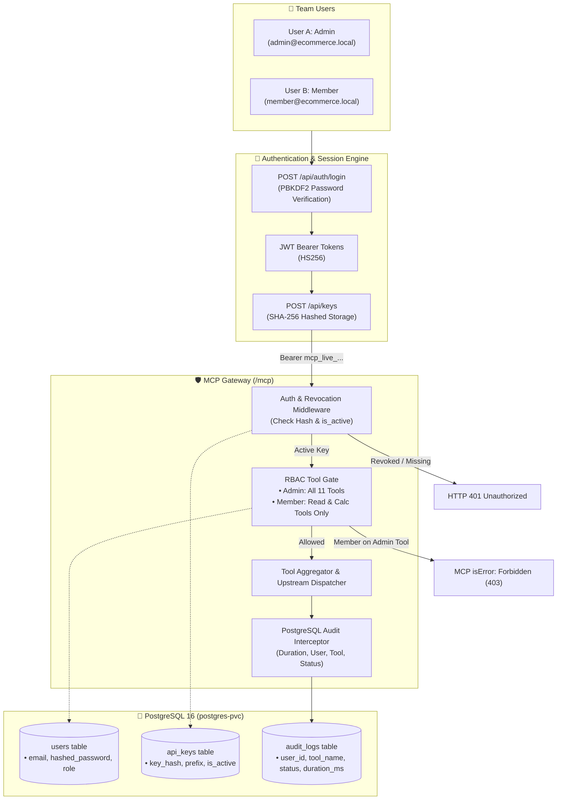

# Days 6–7: Team Access, API Keys, RBAC & PostgreSQL Audit Logging

## 1. Overview & Architecture
Transformed the MCP Gateway into a multi-tenant, enterprise-ready platform supporting independent users, role-based tool gating, cryptographic key hashing, sub-second key revocation, and comprehensive database audit logging.



---

## 2. Implemented Capabilities & Deliverables

### A. Modular MVC Architecture (`services/gateway/`)
- **`models/`**: Dedicated files for `User`, `APIKey`, `AuditLog`, `UpstreamServer`.
- **`core/`**: PBKDF2 password hashing, SHA-256 key hashing, JWT token generator, RBAC rules.
- **`controllers/`**: Modular endpoints:
  - `auth_controller.py`: `POST /api/auth/login`, `GET /api/auth/me`
  - `key_controller.py`: `POST /api/keys`, `GET /api/keys`, `DELETE /api/keys/{id}`
  - `server_controller.py`: `GET /api/servers`, `POST /api/servers`, `PATCH /api/servers/{id}/toggle`
  - `tool_controller.py`: `GET /api/tools`
  - `audit_controller.py`: `GET /api/audit`
  - `mcp_controller.py`: `POST /mcp`

### B. Security & Revocation
- **Plaintext Key Protection**: Displayed only once upon generation; only masked prefix (`mcp_live_xxxx...****`) is ever stored or returned in listings.
- **Immediate Revocation**: `DELETE /api/keys/{id}` immediately deactivates the key; the very next tool call is rejected with `HTTP 401 Unauthorized`.
- **RBAC Boundaries**:
  - `admin`: Can execute all tools including store mutations (`woo__create_product`, `woo__update_order_status`).
  - `member`: Can query store catalogs and run calculations (`woo__list_*`, `calc__*`, `metrics__*`), but attempts to invoke administrative mutations are blocked.

### C. PostgreSQL Audit Trail
- Logs every invocation to `audit_logs` table:
  - `user_id`, `user_email`, `tool_name`, `arguments`, `status` (`success`, `forbidden`, `unauthorized`), `duration_ms`, `timestamp`.

---

## 3. End-to-End Verification (`scripts/test-multi-user-e2e.py`)
Run automated multi-user test suite:
```bash
python3 scripts/test-multi-user-e2e.py
```
**Result**: All 8 validation steps passed (`exit code 0`).
